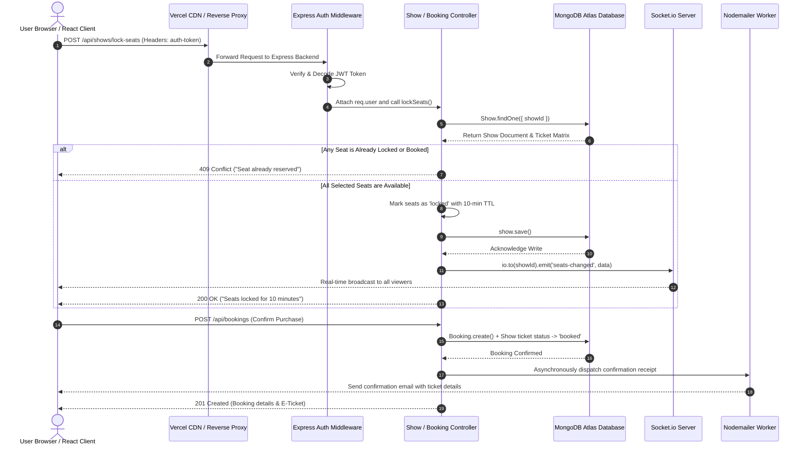

# 🏛️ System Architecture & MVC Pattern Implementation

This document provides a comprehensive technical overview of the **iMovies** cinema booking platform's software architecture, detailing its implementation of the **Model-View-Controller (MVC)** design pattern, end-to-end data lifecycle, real-time concurrency engine, and deployment infrastructure.

---

## 🌟 Architectural Philosophy

The **iMovies** platform is structured around a decoupled, client-server architecture designed for high throughput, real-time concurrency, and modular maintainability:

```
┌─────────────────────────────────────────────────────────────┐
│                   CLIENT TIER (React + Vite)                │
│   Components  •  Custom Hooks  •  Context API  •  Pages     │
└──────────────────────────────┬──────────────────────────────┘
                               │  REST API (Axios) + WebSockets (Socket.io)
                               ▼
┌─────────────────────────────────────────────────────────────┐
│                   SERVER TIER (Node.js + Express)           │
│   Middlewares  •  Routers  •  Controllers  •  Services      │
└──────────────────────────────┬──────────────────────────────┘
                               │  Mongoose ODM (Driver)
                               ▼
┌─────────────────────────────────────────────────────────────┐
│                   DATA TIER (MongoDB Atlas)                 │
│   Document Collections  •  Compound Indexes  •  Aggregation │
└─────────────────────────────────────────────────────────────┘
```

---

## 📐 MVC Pattern Breakdown

In this modern full-stack web application, the **Model-View-Controller** pattern is implemented across both backend services and frontend clients:

```
     ┌──────────────────────────────────────────────────┐
     │                      ROUTER                      │
     │      Dispatches HTTP Request to Controller       │
     └─────────────────────────┬────────────────────────┘
                               │
            ┌──────────────────▼──────────────────┐
            │             CONTROLLER              │
            │   Validates inputs, executes logic, │
            │   orchestrates services & models    │
            └──────────┬──────────────────▲───────┘
                       │                  │
        Queries/Mutates│                  │ Returns Documents
                       ▼                  │
            ┌──────────────────┐  Data    │
            │      MODEL       │──────────┘
            │  (Mongoose Schema│
            │   & Data Layer)  │
            └──────────────────┘
                       │
                       │ Sends JSON Response
                       ▼
            ┌─────────────────────────────────────┐
            │               VIEW                  │
            │  Backend: Standardized JSON DTO     │
            │  Frontend: React Virtual DOM UI     │
            └─────────────────────────────────────┘
```

---

### 1. The Model Layer (`server/models/`)

The Model layer defines the system's business entities, data contracts, validation rules, and schema constraints using **Mongoose ODM** on MongoDB:

| Model File | Collection | Description & Key Attributes |
| :--- | :--- | :--- |
| `userModel.js` | `users` | Normalizes user accounts, enforces unique lowercased emails, and stores bcrypt salted hashes. |
| `adminModel.js` | `admins` | Dedicated administrative entity separating privilege levels from normal customer records. |
| `movieModel.js` | `movies` | Catalogs movie assets, TMDB IDs, genres, certification, media banners, and soft-delete states. |
| `theatreModel.js` | `theatres` | Models theater auditoriums, seating layouts (Balcony, Middle, Lower), and dynamic tier pricing. |
| `showModel.js` | `shows` | Represents scheduled screenings with an embedded, dynamic `tickets` seat-status map. |
| `bookingModel.js` | `bookings` | Immutable transaction ledger recording booked seat identifiers, totals, and payment status. |
| `paymentModel.js` | `payments` | Audit record of gateway order IDs, verification signatures, payment methods, and refund logs. |
| `favoriteModel.js` | `favorites` | User movie watchlist with a compound index (`{ userEmail: 1, movieId: 1 }`). |
| `reviewModel.js` | `reviews` | Community ratings (1-10) and text reviews associated with a user and movie. |

---

### 2. The Controller Layer (`server/controllers/`)

Controllers encapsulate all domain business logic, coordinating data operations between database models and API clients:

- **`authController.js`**:
  - Handles customer and admin registration, bcrypt hashing (12 rounds), credential authentication, and JWT signing (`expiresIn: '7d'`).
  - Session verification routes (`/auth/validate`, `/auth/admin/validate`) return cleansed user metadata without password hashes.
  - Aggregates platform metrics (total bookings, active users, revenues) for the admin console.

- **`movieController.js`**:
  - Implements multi-criteria movie filtering (search term regexp, genre inclusion, language matching).
  - High-performance `.lean()` queries with intelligent 30-second in-memory caching to eliminate redundant database I/O.
  - CRUD operations restricted to authorized administrators.

- **`theatreController.js`**:
  - Automatically generates dynamic 2D seating matrices (`generateSeatLayout(rows, cols)`) if custom layouts are omitted during theater creation.
  - Enforces venue-specific tier pricing across Balcony, Middle, and Lower sections.

- **`showController.js`**:
  - Schedules screening instances and builds the initial seat matrix (`buildInitialTickets`) combining theater layout with tier pricing.
  - Implements **concurrency seat locking**: `lockSeats()` checks whether any selected seat is already locked or booked; if available, marks them `locked` with a 10-minute timestamp.

- **`bookingController.js`**:
  - Finalizes seat purchases by converting locked seats to `booked` status.
  - Generates human-readable booking IDs (`BK<timestamp>`).
  - Triggers non-blocking email confirmations via `mailer.js`.
  - Manages cancellations and restores cancelled seats to `available`.

- **`paymentController.js`**:
  - Coordinates checkout orders, HMAC-SHA256 signature verification, and refund state updates.

- **`favoriteController.js` & `reviewController.js`**:
  - Manages watchlist additions/removals and aggregates movie review score averages.

---

### 3. The View Layer (Dual Implementation)

#### A. Backend API Response Views (Data Transfer Objects)
All backend endpoints return standardized, predictable JSON envelopes:

```json
{
  "success": true,
  "message": "Operation completed successfully",
  "data": { ... }
}
```

Error responses adhere to standard HTTP status conventions:
- `400 Bad Request`: Validation failure or missing required fields.
- `401 Unauthorized`: Missing, expired, or invalid JWT token.
- `403 Forbidden`: Role restriction (e.g. non-admin accessing administrative routes).
- `404 Not Found`: Target entity does not exist.
- `409 Conflict`: Duplicate email, username, or race-condition seat lock conflict.
- `500 Internal Server Error`: Unhandled server exception with sanitized error logging.

#### B. Frontend Presentation Views (`client/src/`)
Built with **React 18** and **Vite**, the client acts as the interactive presentation layer:
- **Pages**: `LandingPage`, `HomePage`, `MovieDetailsPage`, `MovieShowsPage`, `SeatSlugPage`, `BookingsPage`, `ProfilePage`, `AdminDashboard`, `AddMoviePage`, `NotFoundPage`.
- **Theme Engine**: `ThemeContext.jsx` provides dynamic switching between **Midnight Aurora Dark Mode** and **Aurora Cinema Light Mode** via CSS variables.
- **Route Guards**: `UserProtection.jsx` and `AdminProtection.jsx` preserve authentication across browser refreshes using client-side JWT decoding before route hydration.

---

## 🔁 End-to-End Request Lifecycle & Data Flow



---

## ⚡ Concurrency & Real-Time Engine

### 1. Real-Time WebSocket Synchronization (`Socket.io`)
- When viewing a show's seat map, the client joins a dedicated WebSocket room:
  ```javascript
  socket.emit('join-show', showId);
  ```
- Whenever any customer locks, books, or releases seats, the server broadcasts a `seats-changed` event only to clients inside that `showId` room.
- Other active customers see seats turn amber (locked) or red (booked) instantly without refreshing their browsers.

### 2. Automated Lock Expiration (`cleanupService.js`)
- If a customer closes their browser or abandons the checkout flow after locking seats, the seats must not stay locked forever.
- A background `node-cron` scheduled worker runs every **5 minutes**:
  ```javascript
  cron.schedule('*/5 * * * *', () => { releaseExpiredLocks(); });
  ```
- Scans active shows and frees any seat where `seat.status === 'locked'` and `(Date.now() - seat.lockedAt) > 10 minutes`.

### 3. Automated Show Reminders (`reminderService.js`)
- Runs every **10 minutes**:
  ```javascript
  cron.schedule('*/10 * * * *', () => { sendShowReminders(); });
  ```
- Scans confirmed bookings for shows commencing within 115 to 125 minutes and delivers an automated email notification to the customer.

---

## 🛡️ Security, Authentication & Session Architecture

1. **Password Encryption**: All passwords undergo salted bcrypt hashing with a cost factor of 12 prior to database persistence.
2. **Stateless JWT Authorization**:
   - Customer and Administrator tokens are cryptographically signed with `JWT_SECRET`.
   - Client attaches the token in both `Authorization: Bearer <token>` and `auth-token` headers.
   - Separate validation endpoints (`/auth/validate` vs `/auth/admin/validate`) enforce strict role separation.
3. **Session Resilience on Reload**:
   - `UserProtection.jsx` and `AdminProtection.jsx` inspect stored tokens locally to verify signature format and expiration before initiating backend checks.
   - Prevents session drops during network latency or backend cold starts.
4. **Environment Isolation**:
   - Database credentials (`MONGODB_URI`), gateway secrets, and JWT secrets are injected through environment variables and strictly excluded via `.gitignore`.
