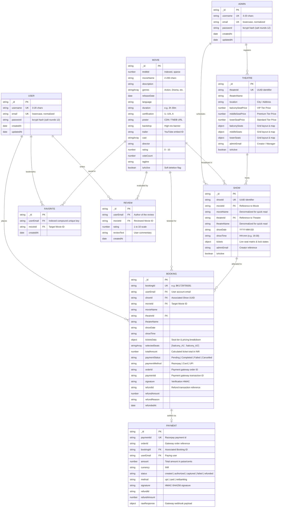

# 🗄️ Database Entity-Relationship (ER) Diagram

This document models the complete data layer and relational schema for the **iMovies** movie ticket booking platform. While MongoDB is a document-oriented NoSQL database, the application enforces referential integrity, unique constraints, and structured relationships across models via Mongoose schemas.

---

## 📊 Visual ER Diagram

---

## 📋 Entity Descriptions & Schema Specifications

### 1. `User` & `Admin`
- **Purpose**: Manage identity, authentication, and role separation.
- **Security**: Passwords hashed using `bcryptjs` with 12 salt rounds. 
- **Tokens**: Issues signed JSON Web Tokens (JWT) with 7-day TTL (`{ id, email, username, isAdmin }`).
- **Separation**: Admins have separate administrative schema and collection to prevent privilege escalation vulnerabilities.

### 2. `Movie`
- **Purpose**: Stores film metadata, media assets, and theatrical distribution properties.
- **Key Features**:
  - Optional `tmdbId` syncing live data from The Movie Database API.
  - Multi-genre classification (`genres: [String]`).
  - Active toggle (`isActive: Boolean`) for non-destructive archiving.

### 3. `Theatre`
- **Purpose**: Physical theater venue layout, tier structures, and dynamic pricing rules.
- **Seat Layout Objects**:
  - `balconySeats`: VIP upper level seating grid with custom row/column assignments.
  - `middleSeats`: Premium view section.
  - `lowerSeats`: Standard pricing section.

### 4. `Show`
- **Purpose**: Represents an active screening scheduled for a specific movie, theater, date, and time.
- **Real-Time Seat Matrix (`tickets`)**:
  - Dynamic key-value dictionary mapping seat labels (e.g. `balcony_B4`) to states:
    - `available`: Open for selection.
    - `locked`: Temporarily held by a user for up to 10 minutes (TTL countdown).
    - `booked`: Confirmed purchase.

### 5. `Booking`
- **Purpose**: Immutable transaction record of confirmed or pending reservations.
- **Audit Trail**: Contains denormalized movie and theater names so historic receipts remain accurate even if an admin renames a theater or movie.

### 6. `Payment`
- **Purpose**: Financial audit log capturing Razorpay payment intents, verification HMACs, order identifiers, and cancellation refunds.

### 7. `Favorite` & `Review`
- **Purpose**: User engagement and social features.
- **Indexes**: `favoriteSchema.index({ userEmail: 1, movieId: 1 }, { unique: true })` strictly enforces that a user can bookmark each movie at most once.
