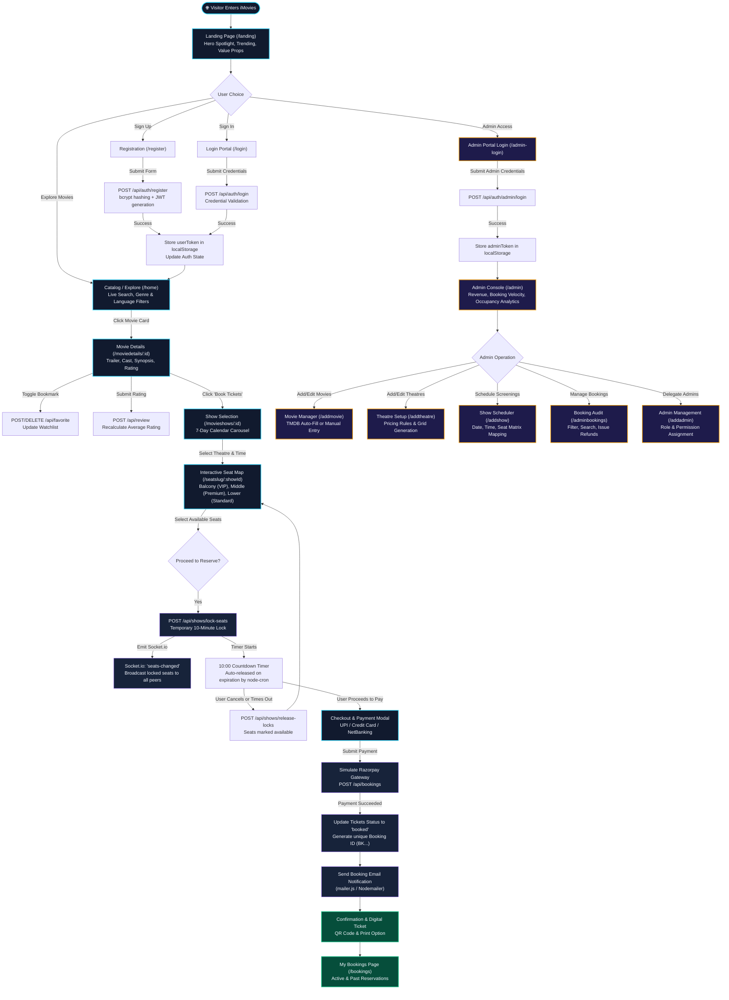

# 🧭 User Flow & System Journey Diagram

This document illustrates the end-to-end journey of users, visitors, and administrators through the **iMovies** cinema booking platform. It details user decisions, authentication checks, real-time seat locking, payment execution, and administrative workflows.

---

## 🔄 End-to-End Visual User Flow

---

## 📌 Phase-by-Phase Walkthrough

### Phase 1: Entry & Discovery
1. **Landing View**: Visitors arrive on the high-impact Midnight Aurora cinema landing page featuring featured billboard trailers and fast CTAs.
2. **Catalog Exploration**: The user navigates to `/home` to browse trending movies with live instant search, multi-genre tag filtering, and language sorting.
3. **Movie Synopsis**: Users click into `/moviedetails/:id` to inspect release dates, age certification, high-definition posters, director/cast badges, and aggregated community reviews.

---

### Phase 2: Show Scheduling & Date Selection
1. **Interactive Day Carousel**: In `/movieshows/:movieId`, the user selects from the next 7 calendar days powered by `dayjs`.
2. **Venue Organization**: Shows scheduled for that day are dynamically grouped by theater venue (`theatreName` and `location`).
3. **Showtime Card**: Displays theater amenities, audio formats, and available time slots.

---

### Phase 3: Interactive Seat Map & Real-Time Locking
1. **Multi-Tier Layout**: In `/seatslug/:showId`, the seat matrix renders distinct tiers:
   - **Balcony (VIP)**: Top-tier elevated seating.
   - **Middle (Premium)**: Center view.
   - **Lower (Standard)**: Front rows.
2. **Concurrency Control**:
   - When a user clicks available seats and confirms selection, a `POST /api/shows/lock-seats` request locks the seats for **10 minutes**.
   - Socket.io immediately emits a `seats-changed` event to all other clients connected to that `showId` room, disabling those seats in real-time.
   - A background cron worker (`cleanupService.js`) running every 5 minutes automatically releases any locks exceeding the 10-minute TTL if checkout is abandoned.

---

### Phase 4: Checkout & Ticket Delivery
1. **Order Summary**: Shows total price, booking fee, tier breakdown, and applied seat numbers.
2. **Payment Processing**: Simulated gateway checkout captures payments securely with transaction status recorded in `Payment` and `Booking` models.
3. **Instant E-Ticket**: Upon payment confirmation, the seat status switches to `booked`, an automated HTML email receipt is dispatched, and the ticket is available on the `/bookings` screen.

---

### Phase 5: Administrative Lifecycle
1. **Access Control**: Admin routes are protected by `AdminProtection.jsx` and backend `fetchAdmin` middleware requiring valid `isAdmin: true` JWT claims.
2. **Live Statistics**: Real-time aggregation of platform revenue, total ticket counts, active screenings, and user growth.
3. **Management Capabilities**: Seamlessly create or archive movie titles, configure custom theater seat layouts with dynamic tier prices, schedule new screening dates, and process cancellations.
